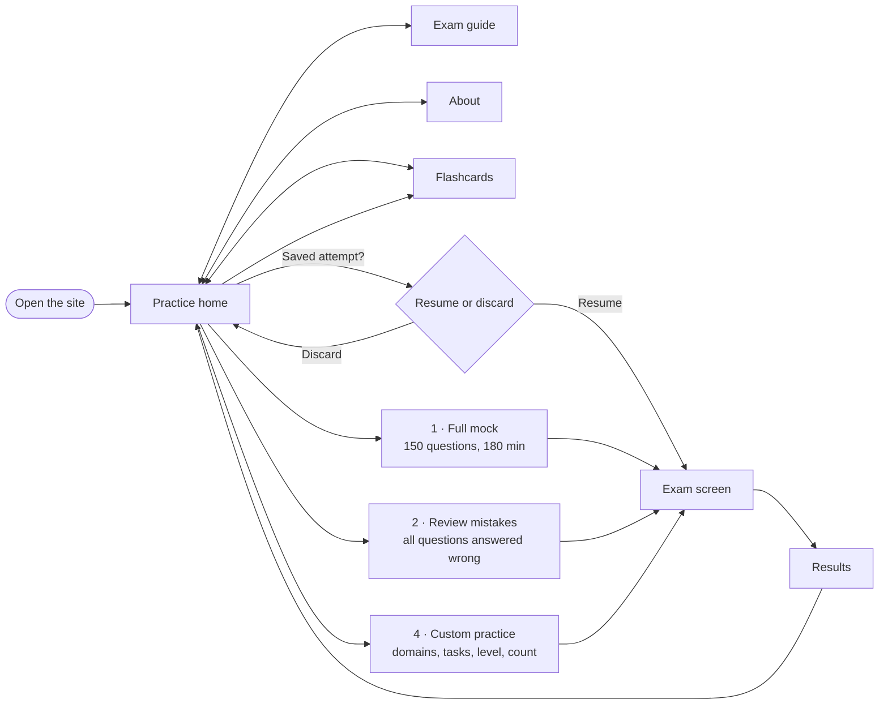
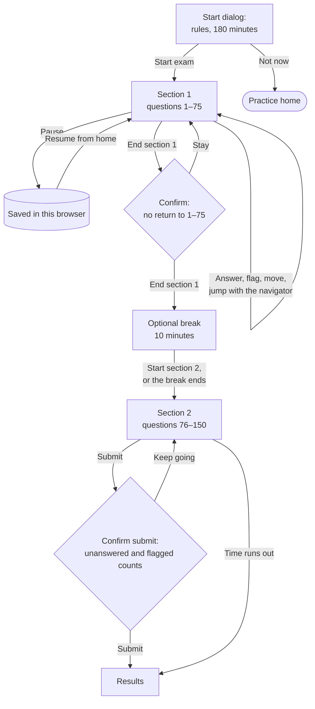
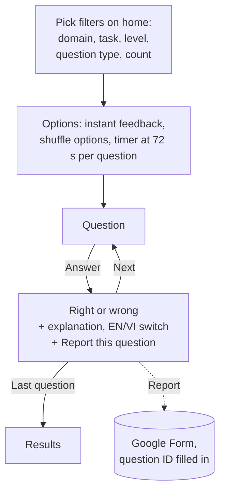
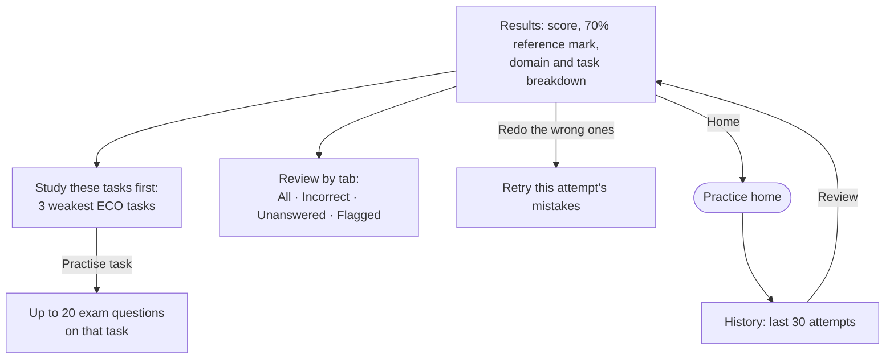
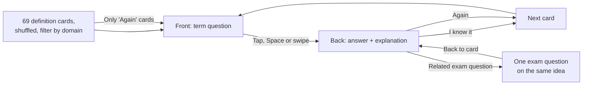

# User flow

How a candidate moves through CAPM Practice Room. GitHub draws the Mermaid diagrams below; in other viewers, paste them into [mermaid.live](https://mermaid.live).

Pages are reached with `#/` links: Practice (`#/`), Exam guide (`#/guide`), Flashcards (`#/cards`) and About (`#/about`). The exam and results screens have no link of their own, so a reload during an attempt returns to Practice, where the attempt can be resumed.

## 1. Overview

## 2. Full mock exam

The mock follows the real exam: questions drawn by ECO weight (54 / 26 / 30 / 40), an optional 10-minute break after question 75, and no return to section 1 after it.

## 3. Practice and review

Custom practice, review mistakes and "practise this task" use the same exam screen, with instant feedback: each answer shows right or wrong, the explanation (EN/VI) and a link to report the question.

## 4. Results and what comes next

## 5. Flashcards

Everything a candidate does is kept only in their browser (`localStorage`, prefix `cpr.`). Visits and the modes started or finished are counted with GoatCounter, without answers or scores (see [decisions.md](decisions.md), D9).
